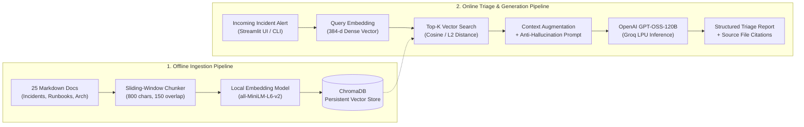

# 🚨 OpsPilot – AI Production Incident Investigation Assistant

OpsPilot is a production-grade **Retrieval-Augmented Generation (RAG)** system designed for DevOps, SRE, and Backend Engineering teams. When production services degrade or fail, OpsPilot ingests incoming alerts or log snippets, retrieves relevant historical incident post-mortems (`INC-101` to `INC-110`), operational runbooks, and service architecture specifications from a local vector database, and synthesizes a grounded root-cause diagnosis and remediation plan with explicit file citations.

## 🎯 Problem Statement & Motivation

During high-severity production outages (e.g., HTTP 503 cascades, database connection exhaustion, or Kafka consumer lag), on-call engineers lose critical minutes searching across scattered post-mortems, runbooks, and architecture wikis. Generic LLMs hallucinate infrastructure details when lacking internal context, while keyword search fails when symptoms are phrased differently from historical root causes.

**OpsPilot bridges this gap by:**
- Indexing internal operational knowledge into dense vector embeddings using [Sentence-Transformers](https://huggingface.co/sentence-transformers/all-MiniLM-L6-v2) (`all-MiniLM-L6-v2`) and [ChromaDB](https://docs.trychroma.com/).
- Retrieving the top-$K$ semantically relevant chunks alongside their vector similarity distances.
- Injecting retrieved evidence into [OpenAI GPT-OSS-120B](https://console.groq.com/docs/model/openai/gpt-oss-120b) via the [Groq API](https://console.groq.com/) under strict anti-hallucination guardrails that enforce exact document citations and refuse out-of-scope queries.

## 🏗️ System Architecture

### 1. End-to-End RAG Pipeline Diagram (Mermaid)

GitHub natively renders the Mermaid diagram below into an interactive flowchart:



### 2. Data & Control Flow Breakdown

1. **Knowledge Base Generation (`generate_data.py`)**: Populates `data/` with 25 realistic engineering documents across 4 operational tiers:
   - **10 Production Incident Post-Mortems (`INC-101` to `INC-110`)**: Covering PostgreSQL pool leaks, Redis OOM evictions, Kafka poison-pill messages, CORS misconfigurations, Stripe webhook signature failures, worker memory leaks (`OOMKilled`), CoreDNS throttling, Elasticsearch read-only disk watermarks, expired Let's Encrypt TLS certificates, and JWT NTP clock skew.
   - **8 Troubleshooting Runbooks (`runbook_*.md`)**: Step-by-step SQL, CLI, and `kubectl` diagnostic flows.
   - **4 Service Architecture Guides (`arch_*.md`)**: Component boundaries, pool limits, timeouts, and failure modes.
   - **3 Operational Procedures & Alert Specs (`proc_*.md`, `spec_*.md`)**: Kubernetes rollbacks, zero-downtime secret rotation, and P1/P2 SLO alert thresholds.
2. **Overlapping Text Chunking (`rag_engine.py`)**: Splits documents into 800-character segments with a 150-character sliding window overlap so multi-step CLI commands and root-cause explanations are never severed mid-sentence.
3. **Local Vector Indexing ([ChromaDB](https://docs.trychroma.com/))**: Embeds chunks locally on CPU using `all-MiniLM-L6-v2` (384-dimensional embeddings) and persists vectors and source metadata (`{"source": filename, "chunk_index": i}`) in `./chroma_db`.
4. **Grounded Synthesis ([OpenAI GPT-OSS-120B](https://huggingface.co/openai/gpt-oss-120b))**: Queries ChromaDB for the top-$K$ chunks, formats each chunk with its source filename and vector distance score, and prompts `openai/gpt-oss-120b` at `temperature=0.1` to produce a deterministic 4-part investigation report.

## 🛠️ Tech Stack & Design Decisions

| Layer | Technology | Engineering Rationale |
| :--- | :--- | :--- |
| **Language** | [Python 3.10+](https://www.python.org/) | Standard ecosystem for AI engineering, vector search, and data pipelines |
| **Embedding Model** | [all-MiniLM-L6-v2](https://huggingface.co/sentence-transformers/all-MiniLM-L6-v2) | Runs locally on CPU in milliseconds with zero API cost and strong semantic recall on technical text |
| **Vector Database** | [ChromaDB](https://docs.trychroma.com/) | Lightweight persistent local storage (`PersistentClient`) requiring no external Docker container setup |
| **LLM Generator** | [OpenAI GPT-OSS-120B](https://console.groq.com/docs/model/openai/gpt-oss-120b) | 117B-parameter Mixture-of-Experts (MoE) open-weight reasoning model served via [Groq](https://console.groq.com/) for sub-second latency |
| **Frontend UI** | [Streamlit](https://docs.streamlit.io/) | Interactive triage workspace with real-time Top-$K$ tuning and raw chunk/distance inspection |
| **Evaluation** | Custom Python Benchmark (`evaluate_rag.py`) | Computes deterministic **Recall@3** and **Mean Reciprocal Rank (MRR)** across ground-truth incident pairs |

## 📂 Repository Structure

```text
opspilot/
├── data/                       # 25 synthetic production markdown files (Incidents, Runbooks, Arch)
├── chroma_db/                  # Persistent local vector database directory (auto-generated)
├── generate_data.py            # Script to generate the 25 engineering documentation files
├── rag_engine.py               # Core ingestion, chunking, ChromaDB retrieval, and GPT-OSS-120B pipeline
├── app.py                      # Streamlit interactive incident investigation dashboard
├── evaluate_rag.py             # Quantitative retrieval evaluation suite (Recall@K & MRR)
├── requirements.txt            # Python package dependencies
├── .env                        # Local environment variables (GROQ_API_KEY) - gitignored
├── .gitignore                  # Excludes venv/, .env, and chroma_db/ from version control
└── README.md                   # Project documentation and architecture guide
```

## 📊 Quantitative Retrieval Evaluation

To verify retrieval quality independently from LLM generation, `evaluate_rag.py` runs 10 realistic production outage queries against the 25-document corpus (38 total chunks) and measures **Recall@3** and **Mean Reciprocal Rank (MRR)**:

| Metric | Result | Benchmark Interpretation |
| :--- | :--- | :--- |
| **Recall@3** | **100.0% (10/10)** | The exact matching historical incident post-mortem was retrieved inside the Top-3 chunks for every test alert |
| **Mean Reciprocal Rank (MRR)** | **0.950** | The ground-truth incident ranked **#1** in 9 out of 10 test queries and **#2** in 1 query (`INC-105`, ranked right behind its companion webhook runbook) |

### Sample Benchmark Output (`python evaluate_rag.py`)

| Test ID | Incident Query Summary | Expected Ground-Truth File | Rank Position | Top-3 Retrieved Sources |
| :--- | :--- | :--- | :--- | :--- |
| **01** | Payment API HTTP 503 & PostgreSQL pool exhausted | `INC-101_database_pool_exhaustion.md` | **Rank #1** | `INC-101`, `arch_payment_service.md`, `runbook_database_troubleshooting.md` |
| **02** | Random user logouts & Redis cluster OOM | `INC-102_redis_cluster_oom.md` | **Rank #1** | `INC-102`, `runbook_redis_cache_operations.md`, `INC-102` |
| **03** | Order emails delayed & Kafka consumer poison pill | `INC-103_kafka_consumer_lag.md` | **Rank #1** | `INC-103`, `runbook_kafka_lag_recovery.md`, `arch_event_driven_pipeline.md` |
| **04** | Checkout blocked by missing CORS header | `INC-104_cors_misconfiguration.md` | **Rank #1** | `INC-104`, `INC-104`, `arch_api_gateway_ingress.md` |
| **05** | Stripe billing webhooks failing with HTTP 400 | `INC-105_stripe_webhook_signing_failure.md` | **Rank #2** | `runbook_third_party_webhook_failures.md`, `INC-105`, `arch_payment_service.md` |
| **06** | PDF export worker crashing with exit code 137 | `INC-106_worker_memory_leak.md` | **Rank #1** | `INC-106`, `INC-106`, `runbook_database_troubleshooting.md` |
| **07** | Microservice 502s & CoreDNS throttling | `INC-107_dns_resolution_timeout.md` | **Rank #1** | `INC-107`, `INC-107`, `runbook_api_gateway_5xx.md` |
| **08** | Catalog search index locked read-only (95% disk) | `INC-108_elasticsearch_disk_watermark.md` | **Rank #1** | `INC-108`, `runbook_elasticsearch_cluster_red.md`, `INC-108` |
| **09** | Public API failing with `ERR_CERT_DATE_INVALID` | `INC-109_tls_certificate_expired.md` | **Rank #1** | `INC-109`, `runbook_ssl_certificate_renewal.md`, `INC-104` |
| **10** | Auth 401 `ImmatureSignatureError` clock skew | `INC-110_jwt_clock_skew_auth_failure.md` | **Rank #1** | `INC-110`, `INC-110`, `INC-102_redis_cluster_oom.md` |

## 🛡️ Reliability & Hallucination Guardrails

1. **Strict Grounding System Prompt**: The LLM is instructed to rely exclusively on retrieved documentation blocks and explicitly cite matching filenames (`INC-xxx.md`, `runbook_*.md`).
2. **Out-of-Scope Refusal**: When tested against unrelated queries (e.g., *"How do I bake a chocolate sourdough cake?"*), OpsPilot refuses to speculate and outputs:
   > *"I couldn't find sufficient information in the available documentation to diagnose this incident."*
3. **Transparent Evidence Inspection**: The Streamlit UI exposes the raw retrieved chunks and their exact vector distance scores alongside the generated report so engineers can audit every recommendation.

## 🚀 Setup & Installation

### 1. Create and Activate Virtual Environment
```powershell
python -m venv venv
.\venv\Scripts\Activate.ps1
pip install -r requirements.txt
```

### 2. Configure Groq API Key
Create a `.env` file in the root directory and add your key from [Groq Console](https://console.groq.com/keys):
```env
GROQ_API_KEY=gsk_your_api_key_here
```

### 3. Generate Knowledge Base & Run Evaluation
```powershell
python generate_data.py
python evaluate_rag.py
```

### 4. Launch Interactive Triage Dashboard
```powershell
streamlit run app.py
```

## 💡 Key Interview Talking Points

- **Why build the RAG pipeline directly in Python instead of hiding everything behind a heavy wrapper?**
  Writing the chunking, metadata tagging, ChromaDB querying, and prompt construction directly in `rag_engine.py` provides full control over chunk boundaries, distance inspection, and system prompt guardrails without framework bloat.
- **How did you choose the chunk size (800 characters, 150 overlap)?**
  Runbooks and incident reports contain dense diagnostic blocks (SQL queries, `kubectl` commands, and 3–4 step remediation lists). An 800-character window captures a complete section header plus its command block, while the 150-character overlap prevents commands or error codes from being split across boundaries.
- **How do you separate retrieval failures from LLM generation failures?**
  By implementing `evaluate_rag.py` with **Recall@3** and **MRR**. If an answer is poor but Recall@3 is 100%, the issue lies in prompt engineering or LLM reasoning; if Recall@3 drops, the issue lies in chunking or embeddings.
